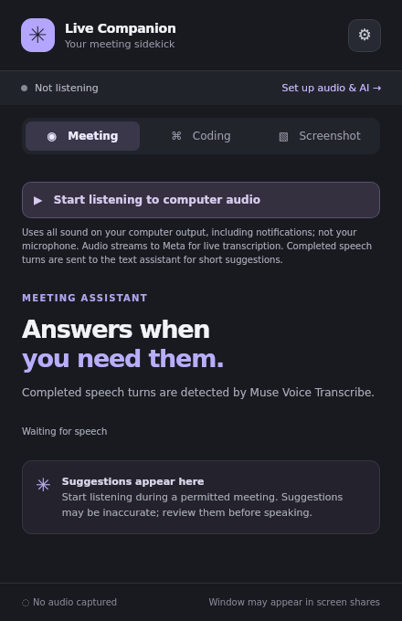

# Pelt Desktop

**Pelt** is a cross-platform AI meeting, coding, and screenshot assistant for Linux and Windows. It combines continuous speech transcription, concise meeting suggestions, coding help, and screenshot analysis in a lightweight desktop app.

Live Companion is a floating meeting and coding assistant built with Tauri 2, Rust, React, and TypeScript. Start the desktop app with `npm install` and `npm run tauri dev` after installing Tauri prerequisites.

The Meeting and Coding microphone flows stream audio to Meta Muse Voice Transcribe (`muse-voice-transcribe-1.0`) over its real-time WebSocket API. Meeting turn boundaries come from Muse `ENDPOINTING` `speechComplete` events rather than a local silence timer. The app sends completed meeting turns to the configured text assistant for concise suggestions. The Coding area also accepts typed questions and optional code/context. In the Coding area, select a screenshot or image and ask a question; it is sent to Meta Muse Spark 1.3 Contributor through the Responses API when the user selects it. No raw audio is saved. Screenshots remain local until the user chooses one for analysis.

Meta and text-provider credentials are stored in the operating system credential store when available and are not written to the session database. The Meta key is used for Muse image analysis and live transcription. The existing text assistant key is used for coding text questions and meeting suggestions. Audio capture requires an explicit user action and remains visibly indicated. Privacy stop ends audio capture and cancels pending answer work; data already sent to providers cannot be recalled.

Linux computer audio uses the default PipeWire/PulseAudio output monitor. Windows uses WASAPI loopback for the default speaker and the default microphone for coding. Computer audio includes all sound on the output, including notifications. macOS transcription is not implemented. The Windows capture implementation and Meta account/model access still require verification on a real Windows machine with valid credentials.

The window is configured to stay on top. On Windows and macOS the app can request OS content protection, but the effect depends on the OS and sharing app. Linux does not support this request through the current window library. Do not assume capture exclusion or invisibility; verify the actual setup.

Use `scripts/prepare_resources.sh all` to stage local packaged speech assets/runtime as needed by the release configuration. See [BUILDING.md](BUILDING.md) for build requirements and [THIRD_PARTY_NOTICES.md](THIRD_PARTY_NOTICES.md) for bundled components.
